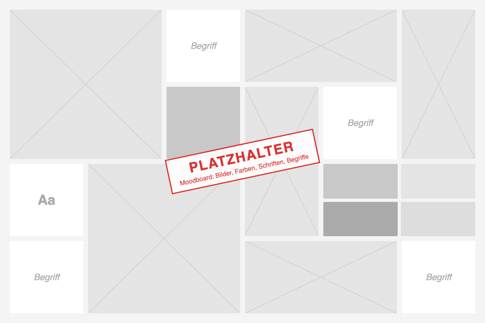
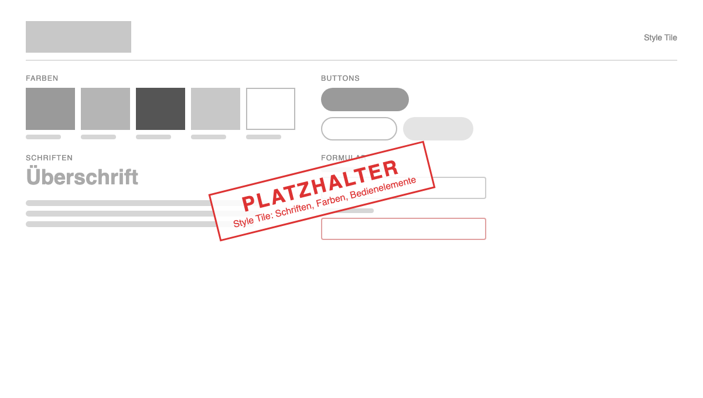
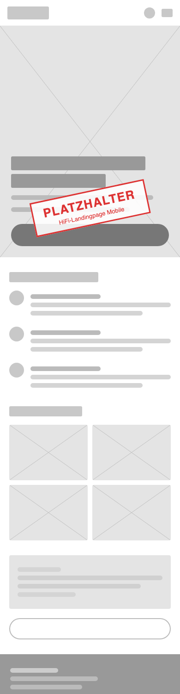
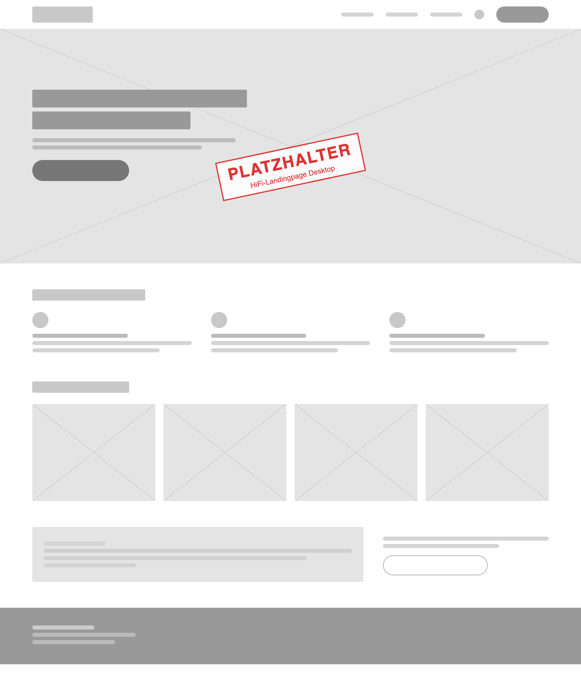

# Aureon Mining Capital
Thema: Wir sind eine spezialisierte Investment Gesellschaft, die Anlegern die Möglichkeit bitete in ausgewählte Gold- und Silberminenprojekte zu Investieren und von deren wirtschaftlichem Potenzial zu profitieren.

## Hinweise zur Vorlage (vor der Abgabe löschen)

Die Beispiele in dieser Vorlage stammen aus einem erfundenen Projekt (Leergut-Taxi, ein mobiler Abholdienst für Leergut) und zeigen nur, wie ein Eintrag aussehen kann. Die Bilder unter `specs/` sind Platzhalter. Ersetzen Sie alles durch Ihr eigenes Projekt und füllen Sie die `TODO`-Stellen. Hinweise in `<!-- … -->` sehen Sie nur in der Quelle, nicht in der Vorschau.

Alles, was Sie abgeben, schreiben Sie als Markdown-Dateien mit Bildern in genau dieser Struktur. In der L4-Vorbereitung legen Sie das Git-Repository Ihres Projekts an und kopieren die Dateien hinein. Ab dann liest auch der Coding-Agent sie.

```text
<teamname>/
├── README.md     # Aufgabe 1 und 4: Idee, Ziele, Persona, Figma-Link, Design
├── SPECS.md      # Aufgabe 2 und 5: Use Cases, Datenmodell
└── specs/
    ├── usecases.puml, usecases.svg     # Use-Case-Diagramm
    ├── datamodel.puml, datamodel.svg   # Klassendiagramm
    ├── usecase-<kurzname>-requirements.md   # Aufgabe 3
    ├── figma/    # Aufgabe 3: Wireframes (PNG)
    └── design/   # Aufgabe 4: Moodboard, Style Tile, Landingpage (PNG)
```

Markdown-Dateien sehen Sie in VS Code mit der Vorschau an (`Strg+K V` bzw. `Cmd+K V`). Diagramme zeichnen Sie am besten mit [PlantUML](https://plantuml.com/de/), weil die Quelle Text ist, den Sie und später der Agent lesen und ändern können. Mit der VS-Code-Erweiterung *PlantUML* erzeugen Sie daraus SVG-Dateien. draw.io ist auch erlaubt (als `.drawio.svg` speichern).

Terminbuchung für Leergut-Taxi, einen mobilen Dienst in Konstanz, der leere Pfandflaschen und Getränkekisten an der Haustür abholt.

Figma: TODO Link mit Leserechten

## Ausgangslage

<!-- Ein Absatz: Wer hat welches Problem, und wie wird es heute gelöst? -->
Privatanleger, die in Gold- und Silberminen investieren möchten, stehen häufoig vor Problem, geeignete Minenprojekte zu finden und deren Chancen und Risiken einzuschätzen.Informationen zu Explorationsprojekten, Probenergebnissen und Investitionsmöglichkeiten sind oft auf verschiedene Plattformen verteilt und für unerfahrene Anleger schwer verständlich. Bisher erfolgt der Zugang zu solchen Investments meist über Minenaktien, Rohstofffonds oder spezialisierte Investmentanbieter. Aureon Mining Capital soll diesen Prozess vereinfachen, indem ausgewählte Minenprojekte, Explorationsdaten und eigens zusammengestellte Investmentfonds auf einer zentralen Plattform übersichtlich präsentiert und vergleichbar gemacht werden.

## Ziele
1. Kund:innen können über die Website Termine für persönliche Investmentberatungen buchen und zwischen einem Vor-Ort-Termin und einem Online-Meeting wählen
2. Minenanbieter können sich Online bei uns bewerben
3. Kund:innen können Fonds und Aktien einfach online kaufen und die Anteile werden dann im Depot angezeigt 
4. Kund:innen können vor Investition eine Variation erwarteter Gewinne oder Verlustrisiko einsehen 

<!-- Drei bis fünf Ziele als vollständige Sätze: Wer kann was erreichen? -->

## Komplexe UseCases
1. Kommunikationsmöglichkeit auf der Website z.B Nachrichten oder Meetings (Zwei Personen)
2. Minenanbieter bewerbungen über Website und Antwort über Website (Zwei Personen)
3. Kauf/Verkauf von Akien und auf andere Seite einbuchung und berechnung von Kurs (Seitenübergreifend)
4. Prognose für Investition (Seitenübergreifend)

## Persona
**Heinrich, 35, Anwalt, München**

- **Situation:** Heinrich ist 35 Jahre alt, arbeitet als erfolgreicher Anwalt in München und verfügt über ein überdurchschnittliches Einkommen. Aufgrund seines zeitintensiven Berufsalltags hat er wenig Zeit, sich selbst mit verschiedenen Anlagemöglichkeiten auseinanderzusetzen. Deshalb sucht er nach einer Möglichkeit, sein Geld langfristig und möglichst unkompliziert anzulegen.
- **Ziele:** Heinrich möchte langfristig ein hohes Vermögen aufbauen, ohne viel Zeit in die Verwaltung seiner Investments investieren zu müssen. Er möchte seine Anlagen jederzeit einsehen, zusätzliches Kapital investieren und bei Bedarf Auszahlungen beantragen können. Außerdem legt er großen Wert auf persönliche Beratung und eine vertrauensvolle Beziehung zu seinen Vermögensverwaltern
- **Probleme:** Heinrich fehlt die Zeit, einzelne Gold- und Silberminen sowie deren wirtschaftliche Entwicklung selbst zu analysieren. Zudem fällt es ihm schwer, die Risiken verschiedener Minenprojekte einzuschätzen. Er möchte keine unübersichtlichen Investmentplattformen nutzen und legt großen Wert auf transparente Informationen und zuverlässige Ansprechpartner.
- **Nutzung:** Heinrich nutzt die Website hauptsächlich auf seinem Smartphone, um während kurzer Pausen sein Portfolio und dessen Entwicklung zu überprüfen. Zuhause kann er sich über Smartphone und andere geräte über die Minen informieren und aktuelle Standpunkte und Errungenschaften beobachten. Bei Fragen oder größeren Investitionsentscheidungen vereinbart er direkt über die Website einen persönlichen Beratungstermin.


## Design

### Moodboard



<!-- Optional: zwei, drei Sätze zur Stimmung, die Sie treffen wollen -->

### Style Tile



### Landingpage

Mobile:



Desktop:



## Weitere Dokumente

- [SPECS.md](SPECS.md): Use Cases und Datenmodell
- [specs/usecase-pickup-requirements.md](specs/usecase-pickup-requirements.md): Use Case „Abholung buchen“ im Detail
-+
