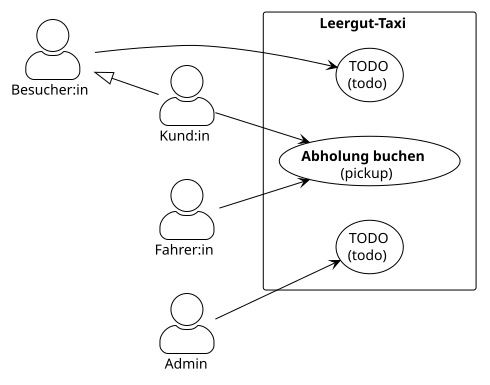
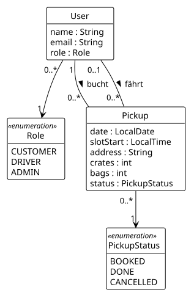

# Spezifikation Leergut-Taxi

## Use Cases

Quelle: [specs/usecases.puml](specs/usecases.puml)

Akteure:

- **Besucher:in:** nicht angemeldet, TODO
- **Kund:in:** angemeldet, bucht Abholungen und sieht ihre Termine. Kann alles, was Besucher:innen können.
- **Fahrer:in:** angemeldet, sieht die Abholungen des Tages und hakt erledigte ab.
- **Admin:** TODO

Anmelden und Registrieren übernimmt Auth0, dafür gibt es keinen eigenen Use Case.

<!-- Eine Zeile pro Use Case, in der Reihenfolge, in der Sie sie umsetzen wollen.
     Komplexe Vorgänge mit Grund kennzeichnen (mehrere Seiten mit gespeicherten Daten oder mehrere Benutzer:innen). -->

| Kurzname | Name | Akteur | Beschreibung | Komplex |
| --- | --- | --- | --- | --- |
| `pickup` | Abholung buchen | Kund:in | Kund:in wählt einen Tag und ein freies Zeitfenster und gibt an, wie viel Leergut abgeholt werden soll. Die Fahrer:in sieht die Abholung in ihrer Tagesliste. Details: [usecase-pickup-requirements.md](specs/usecase-pickup-requirements.md) | ja, mehrere Benutzer:innen |
| `TODO` | TODO | TODO | TODO | TODO |

TODO: Welchen Use Case setzen Sie im L4-Hackathon um, und was muss dafür schon vorhanden sein?

## Datenmodell

Quelle: [specs/datamodel.puml](specs/datamodel.puml)

<!-- Ein Punkt pro Klasse: Was bedeutet sie fachlich? Begründen Sie Entscheidungen, die nicht offensichtlich sind. -->

- **Pickup:** eine gebuchte Abholung an einem Tag in einem Zeitfenster. Die Adresse wird in die Abholung kopiert, weil Kund:innen auch für eine andere Adresse buchen können (z. B. Büro).
- **TODO:** TODO
