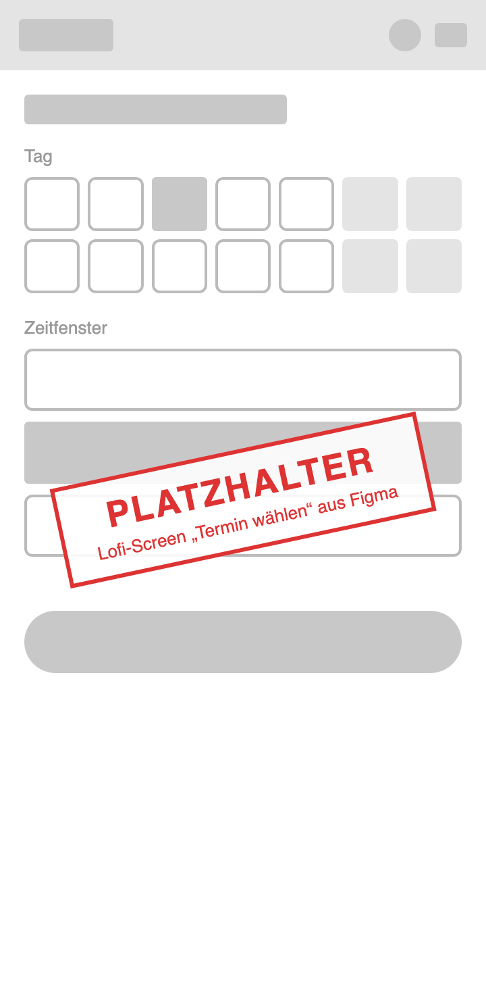
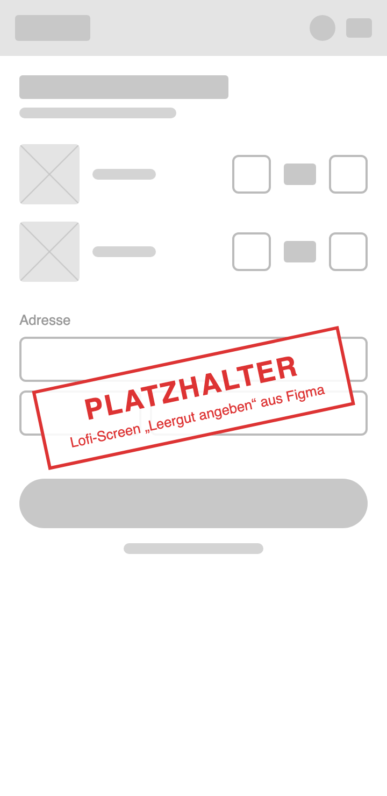

# Use Case: pickup

<!-- Beschreiben Sie, WAS passiert, nicht WIE es technisch umgesetzt wird.
     Akzeptanzkriterien (Given/When/Then) ergänzen Sie erst in der Vorbereitung auf L4. -->

- Name: Abholung buchen
- Zusammenfassung: Kund:in bucht für einen Tag ein freies Zeitfenster und gibt an, wie viele Kisten und Beutel mit Leergut abgeholt werden sollen. Die Fahrer:in sieht die Abholung in ihrer Tagesliste.
  - Standardablauf:
    1. Kund:in klickt auf „Abholung buchen“.
    2. System zeigt die nächsten 14 Tage. Tage ohne freies Zeitfenster sind ausgegraut.
    3. TODO
  - Erweiterungen:
    - 2a. In den nächsten 14 Tagen ist kein Zeitfenster frei: System zeigt „Leider sind alle Termine belegt. Bitte schauen Sie in ein paar Tagen wieder vorbei.“
    - TODO
- Akteur: Kund:in
- Auslösendes Ereignis: Im Keller stapelt sich das Leergut.

## Daten

<!-- Ein- und Ausgaben, wo nötig: Welche Daten gibt der Akteur ein oder sieht er? Welche sind Pflicht? Welche Werte sind erlaubt? -->

- Anzahl Kisten: Pflicht, ganze Zahl von 0 bis 10; Kisten und Beutel zusammen mindestens 1
- TODO

## Screens

<!-- Zwei bis vier Wireframes (Mobile) aus Figma, als PNG nach specs/figma/ exportiert.
     Darunter als Text: Welcher Screen gehört zu welchen Schritten? Keine Anmerkungen ins Bild. -->

- Termin wählen: Schritte 1–2 und 2a
- Leergut angeben: TODO
- TODO

## Out of scope

- Die Bezahlung des Pfands an die Kund:in. Sie wird bei der Abholung bar erledigt.
- TODO
